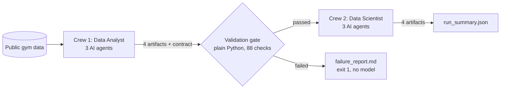

# Golden Fighter AI — Retention Intelligence

A **CrewAI Flow** that predicts which gym members are likely to leave, built from **two AI crews with a
machine-enforced contract between them**. Final project for the course "AI Development & Collaboration"
(brief: *Industry-Simulated AI Product Workflow*, the Harbor & Vale scenario).

> In the brief, the analysts changed a column from cents to dollars, the data scientists' model retrained on it
> without a single error, and it scored customers wrongly for five weeks. This project builds the missing piece:
> a contract that one crew writes and the other must honour, and a gate that stops the pipeline with a readable
> error before a model is trained on broken data.



- **Crew 1 — Data Analyst** (Data Quality Engineer, EDA & Insights Analyst, Data Contract Specialist) cleans
  and explores the data and publishes `clean_data.csv`, `eda_report.html`, `insights.md` and
  `dataset_contract.json`.
- **Validation gate** compares the data with the contract: columns, types, missing values, allowed values,
  ranges, units, cross-column rules and the model's features. **No language model decides pass or fail.**
- **Crew 2 — Data Scientist** (Feature Engineer, Model Trainer & Evaluator, Model Card Specialist) reads only
  Crew 1's published files and produces `features.csv`, `model.joblib`, `evaluation_report.md` and `model_card.md`.
- **Design rule:** the numbers come from tested, seeded Python code; the agents run that code through tools and
  explain the results. Checks stop agents from writing numbers that the code did not produce.
- **Streamlit app** (Hebrew) shows the results, a prediction form and a live "break the data" demo.

Details: [`docs/architecture.md`](docs/architecture.md). Course requirements, item by item:
[`docs/requirements_checklist.md`](docs/requirements_checklist.md).

## Results (from the committed artifacts)
| | |
|---|---|
| Data | 4,000 gym members, 26.5% churned (public Kaggle data, not real Golden Fighter customers) |
| Validation gate | passed, 88 checks, 0 errors |
| Selected model | logistic regression (best mean 5-fold CV ROC-AUC on the training set: 0.9565) |
| Test set (800 members never seen) | ROC-AUC 0.957, recall 90.1% (catches 9 in 10 leavers), precision 74.3% |
| Compared with | majority baseline (ROC-AUC 0.500), random forest (0.948), leakage experiment (0.977, never used: it sees the churn month) |
| Live end-to-end run | Claude Haiku 5.5, run `20261028T162349Z-07b240`: succeeded, 17 model API calls, 41,368 tokens, about $0.007 |
| Break demo | dollars → cents in a copy of the data: the gate refuses, Crew 2 never starts, exit code 1 |

## Quick start (Windows, PowerShell)
Requirements: **Python 3.12** (CrewAI does not support 3.14) and about 1.5 GB of disk for the dependencies.
Clone into a **short path** such as `C:\projects\`: one CrewAI dependency installs very long file paths, and
Windows refuses paths over 260 characters unless long-path support is enabled.

```powershell
git clone <repository-url> golden-fighter-ai
cd golden-fighter-ai
py -3.12 -m venv .venv
.\.venv\Scripts\python.exe -m pip install -r requirements.txt
.\.venv\Scripts\python.exe -m pip install -e .
```

**Get the data** (one time): download `archive.zip` from
[Kaggle](https://www.kaggle.com/datasets/adrianvinueza/gym-customers-features-and-churn), extract
`gym_churn_us.csv`, rename it to `gym_churn.csv` and put it in `data/raw/`. The steps and the file's SHA-256
are in [`data/raw/DATA_SOURCE.md`](data/raw/DATA_SOURCE.md).

**Run it** (no API key needed for any of these):
```powershell
.\.venv\Scripts\python.exe -m pytest -q                                   # 228 tests, about 2 minutes
.\.venv\Scripts\python.exe -m golden_fighter.flow.main --no-llm           # the whole Flow, free (exit 0)
.\.venv\Scripts\python.exe -m golden_fighter.flow.main --demo-break unit_x100   # break it on purpose (exit 1)
.\.venv\Scripts\python.exe -m streamlit run app/streamlit_app.py          # the app: http://localhost:8501
```
`--no-llm` runs the same Flow with the tested pipelines doing the crews' work and writes to
`artifacts/_no_llm/`; `--demo-break` works on a copy in `artifacts/_broken/`. Neither can overwrite the
validated artifacts. Every run leaves `run_summary.json` (and, on failure, `failure_report.md`) in its `runs/`
folder.

**Run it with the AI agents** (uses the Anthropic API and costs money; about $0.007 per run with Haiku 5.5):
```powershell
copy .env.example .env      # then put your key in ANTHROPIC_API_KEY (never commit .env)
.\.venv\Scripts\python.exe -m golden_fighter.flow.main --no-retries
```
The model comes from `GF_LLM_MODEL` (default `anthropic/claude-haiku-5-5`). Each crew is capped at 20 model
API calls; token usage and estimated cost are logged for every run.

## More commands
| What | Command (prefix `.\.venv\Scripts\python.exe`) |
|---|---|
| Crew 1's deterministic pipeline | `-m golden_fighter.analysis.pipeline` |
| The gate on `artifacts/analyst/` (exit 0 / 1) | `-m golden_fighter.contract.gate` |
| Break a copy + run the gate (13 scenarios: `--list`) | `scripts\break_data.py unit_x100` |
| Crew 2's deterministic pipeline | `-m golden_fighter.modeling.pipeline` |
| Gate + Crew 2 on existing Crew 1 artifacts | `-m golden_fighter.flow.main --from-artifacts` |
| One crew with real agents (paid) | `-m golden_fighter.crews.run analyst` or `scientist` |

Exit codes of the Flow: 0 succeeded, 1 validation failed (no model trained), 2 crew/API/setup error.

## Repository
```
app/                   Streamlit app (Hebrew, right to left)
artifacts/analyst/     Crew 1 outputs      artifacts/scientist/   Crew 2 outputs
artifacts/runs/        run_summary.json of the verified live run
data/raw/              DATA_SOURCE.md (the CSV itself is downloaded, see above)
docs/                  architecture, requirements checklist, GitHub plan, presentation
src/golden_fighter/    analysis, contract (gate), modeling, tools, crews, flow, dashboard
tests/                 pytest suite; a scripted mock LLM drives the real crews, no API key needed
```
`clean_data.csv` and `features.csv` hold one row per member and are regenerated by any run; they are not
committed while publication of the data is pending (see below).

## Data and license
"Gym customers features and churn" by Adrian Vinueza on Kaggle, licensed
[CC BY-NC-SA 4.0](https://creativecommons.org/licenses/by-nc-sa/4.0/): credit the creator, non-commercial use
only, and share adaptations under the same license. Changes made here: columns renamed, a `member_id` row
number added, validation and documentation. The data is public and anonymised; no private or CRM data is
used. Details: [`data/raw/DATA_SOURCE.md`](data/raw/DATA_SOURCE.md).

## Project status
M0–M6 complete (data layer, gate, models, crews, Flow, app); M7 submission preparation and M8 presentation in
progress. Progress, verified results and known issues: [`PROJECT_PROGRESS.md`](PROJECT_PROGRESS.md).
