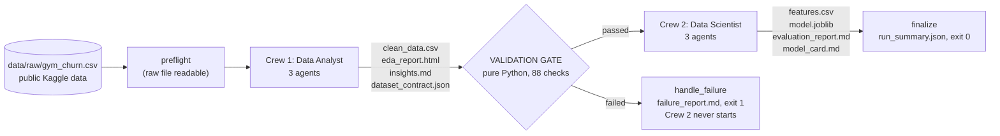

# Architecture

Golden Fighter AI predicts which gym members are likely to leave at the start of a month. It answers the course
brief (Harbor & Vale): two CrewAI crews that work as one team, with a **contract between them that machines
enforce**, connected by a Flow that stops with a readable error when the data breaks the contract.

## 1. The Flow



`src/golden_fighter/flow/main.py` defines `GoldenFighterFlow(Flow[FlowState])` with CrewAI's Flow decorators:

| Step | Decorator | What it does |
|---|---|---|
| `preflight` | `@start` | Raw file exists, is readable and has the expected raw columns. |
| `analyst` | `@listen(preflight)` | Runs Crew 1 (or re-uses its artifacts with `--from-artifacts`). |
| `validation_gate` | `@router(analyst)` | Runs `contract/validator.py run_gate`; returns `"passed"` or `"failed"`. |
| `scientist` | `@listen("passed")` | Runs Crew 2. Reachable **only** through the gate's `"passed"` route. |
| `check_scientist` | `@router(scientist)` | `"succeeded"` if every Crew 2 artifact was written in this run, else `"failed"`. |
| `finalize` / `handle_failure` | `@listen("succeeded")` / `@listen("failed")` | `run_summary.json`; on failure also `failure_report.md`. |

Every stage catches its own errors and records them in the Flow state, so any failure (bad data, API error,
missing output) always ends in `handle_failure` with a clear reason. Exit codes: 0 succeeded, 1 validation
failed (no model trained), 2 crew/API/setup error.

**Stale-output protection.** Before each crew runs, the Flow snapshots its output files (modification time and
size). A file only counts as an output of this run if this run rewrote it, so an old `model.joblib` can never
make a failed run look successful.

## 2. The six agents and their tools

Agents decide which tool to call and write the explanations. The tools wrap plain, tested Python functions, so
**every number is computed by code, never by the language model.**

| Crew | Agent | Tools | Writes |
|---|---|---|---|
| 1 Data Analyst | Data Quality Engineer | `profile_raw_data`, `clean_data` | `clean_data.csv`, `cleaning_report.json` |
| 1 Data Analyst | EDA & Insights Analyst | `run_eda`, `write_insights_summary` | `eda_report.html`, `insights.md` |
| 1 Data Analyst | Data Contract Specialist | `build_contract`, `contract_self_check` | `dataset_contract.json` |
| 2 Data Scientist | Feature Engineer | `inspect_contract`, `build_features` | `features.csv` |
| 2 Data Scientist | Model Trainer & Evaluator | `train_and_compare_models` | `model.joblib`, `evaluation.json` |
| 2 Data Scientist | Model Card Specialist | `write_model_reports`, `write_model_card_summary` | `evaluation_report.md`, `model_card.md` |

Definitions: `crews/*/config/agents.yaml` and `tasks.yaml`; tools: `src/golden_fighter/tools/`.

Guardrails around the agents (`tools/`, `crews/runner.py`):
- **Fixed paths.** Tools are built with their input/output folders; agents never pass a path. Crew 2's tools
  can only read `artifacts/analyst/`, never `data/raw/` or Crew 1's code.
- **Number grounding.** Text an agent saves (insights, model-card summary) may only contain numbers that
  appear in the computed facts (`insight_facts.json` / `evaluation.json`).
- **Source check.** Every final answer is checked by a CrewAI guardrail: each number must appear in the
  result of the tool it is credited to. One rewrite is allowed, then the crew stops.
- **Budget.** At most 20 model API calls per crew, 2,048 output tokens per response; usage and estimated cost
  are logged for every run.

## 3. The contract and the gate

`dataset_contract.json` (pydantic schema in `contract/schema.py`) is **the only thing Crew 2 may assume**.
For every column it records type, nullability, allowed values or min/max, unit, expected mean range, whether
it is known before churn, and its role (target, identifier, feature, forbidden, leakage risk). It also holds
cross-column rules (months left ≤ contract length), the expected churn-rate range, the minimum row count and
the SHA-256 of the clean file.

The gate (`contract/validator.py`) is deterministic Python; no language model ever decides pass or fail. It
collects **all** violations, not just the first:
- dataset vs contract: schema, dtypes, nulls, allowed values, ranges, mean range (unit-change detection),
  cross-column rules, target rate, duplicate ids, fingerprint warning;
- model features vs contract: target or forbidden columns, unknown columns, leakage-risk columns, columns not
  available before churn, missing features.

`contract/breakers.py` has 13 "break it on purpose" scenarios (unit ×100, renamed column, dropped column,
impossible ages, corrupt contract, ...). Each one makes the gate fail with a named, readable reason, and the
tests check every one.

## 4. Modeling

`modeling/` (all seeded, `SEED = 42`):
- Stratified 80/20 split; three engineered features computed row by row inside the model pipeline.
- Models: majority baseline, logistic regression, random forest, each a full scikit-learn `Pipeline`
  (preprocessing fitted on training folds only).
- Selection: best mean 5-fold cross-validation ROC-AUC on the training set; the test set is used only to report.
- Leakage ablation: the selected model retrained **with** the leaky current-month visit column, reported
  for comparison and never selectable.
- Evaluation: ROC-AUC, PR-AUC, recall, precision, F1, accuracy, confusion matrix, permutation importance,
  fairness by gender code and age band, and a warning if any ROC-AUC exceeds 0.99.

## 5. Reproducibility

- Numeric steps are deterministic: running the pipelines twice gives byte-identical `clean_data.csv`,
  features, model metrics and EDA report (tested).
- `.gitattributes` fixes line endings so file hashes match on every OS.
- Every run writes `artifacts/runs/<run_id>/run_summary.json` (stages, gate result, which files this run
  produced, model API calls, agent tool executions, tokens, estimated cost, headline metrics).
- Free modes: `--no-llm` (deterministic pipelines instead of agents, writes to `artifacts/_no_llm/`) and
  `--demo-break SCENARIO` (works on a copy in `artifacts/_broken/`). Neither can overwrite the validated
  artifacts.

## 6. The Streamlit app

`app/streamlit_app.py` + `app/screens/` (Hebrew, right to left), data layer in `src/golden_fighter/dashboard/`.
Six screens: overview, churn insights (with a Hebrew view of the EDA report), model performance, prediction for
one member, runs and costs, and the break-the-data demo. The app never calls the Claude API and never reads
API keys (a static test enforces this). Its two buttons are free: a Flow run without AI, and the break demo on a
copy. Hebrew reports are generated from the same JSON as the English deliverables; a test checks that they
contain no number the verified results do not have.

## 7. Repository layout

```
app/                     Streamlit app (streamlit_app.py + screens/)
artifacts/analyst/       Crew 1 outputs (clean_data.csv is gitignored until data publication is approved)
artifacts/scientist/     Crew 2 outputs (features.csv likewise)
artifacts/runs/          run_summary.json of committed runs
data/raw/                DATA_SOURCE.md (+ the Kaggle CSV, gitignored)
docs/                    architecture, requirements checklist, GitHub plan, presentation
scripts/break_data.py    break a copy on purpose and run the gate
src/golden_fighter/
  analysis/              cleaning, EDA, insights, leakage scan, Crew 1 pipeline
  contract/              contract schema + builder, validator (the gate), break scenarios
  modeling/              features, training, evaluation, reports, prediction, Crew 2 pipeline
  tools/                 CrewAI tools, grounding and source checks
  crews/                 analyst_crew/ and scientist_crew/ (YAML + crew.py), runner
  flow/                  the CrewAI Flow, its state, artifacts snapshots, reports
  dashboard/             data layer and Hebrew texts for the app
tests/                   pytest suite (no API key needed; a scripted mock LLM drives the real crews)
```
